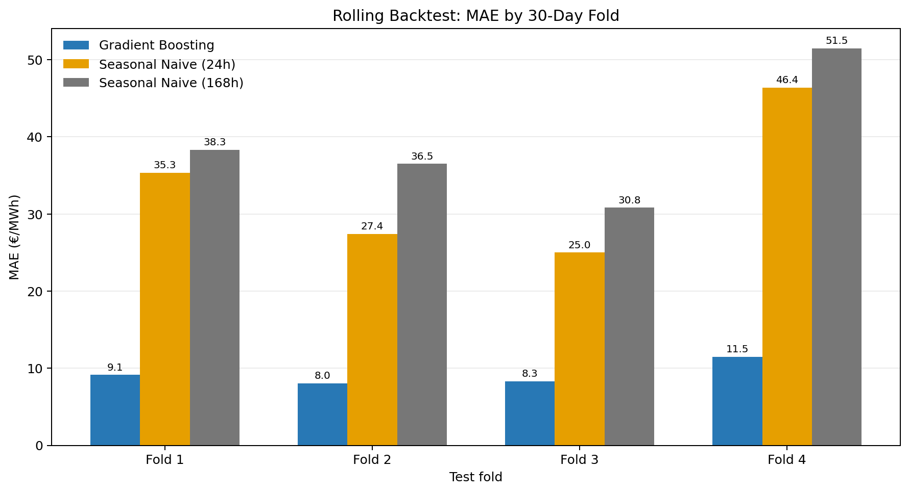
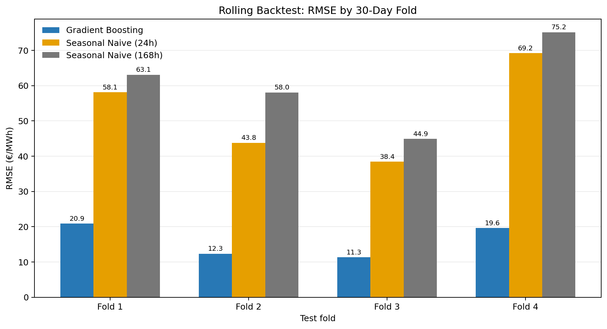
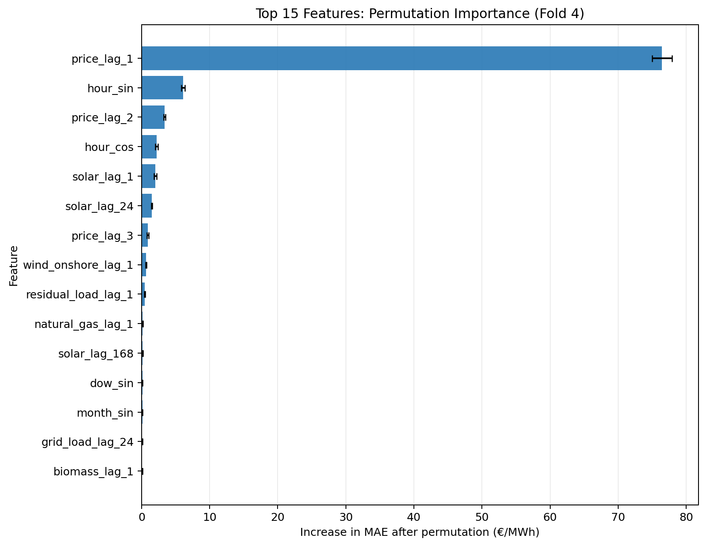
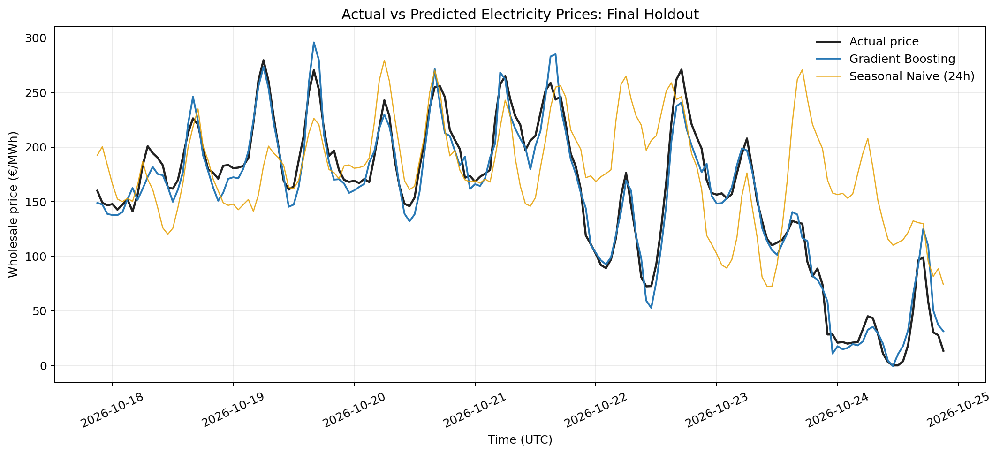

# German Electricity Price Forecasting & Input-Output Analysis

A reproducible Python research project combining **hourly German wholesale electricity price forecasting** with a separate **input-output (IO) economic analysis framework**.

The project uses real hourly electricity-market data to evaluate machine-learning forecasting against seasonal-naive benchmarks. It also provides a foundation for studying the relationship between energy markets, production structures, and economic scenarios through input-output methods.

> **Project status:** The real-data hourly forecasting pipeline has been evaluated using an expanding-window rolling backtest. The current results represent rolling one-step-ahead forecasting, not a fully independent day-ahead forecast. The input-output component is a separate analytical framework and should not be interpreted as a validated causal extension of the hourly forecasting results.

## Table of Contents

- [Project Overview](#project-overview)
- [Key Results](#key-results)
- [Data](#data)
- [Forecasting Methodology](#forecasting-methodology)
- [Model Evaluation](#model-evaluation)
- [Feature Importance and Interpretation](#feature-importance-and-interpretation)
- [Visual Results](#visual-results)
- [Input-Output Analysis](#input-output-analysis)
- [Project Structure](#project-structure)
- [Installation and Setup](#installation-and-setup)
- [Running the Pipeline](#running-the-pipeline)
- [Limitations and Future Work](#limitations-and-future-work)
- [Reproducibility and Data Policy](#reproducibility-and-data-policy)

## Project Overview

Electricity prices vary substantially across hours because of demand patterns, generation availability, renewable energy production, and other market conditions. Forecasting these prices is challenging, particularly during periods of scarcity, rapid changes in renewable generation, and extreme price events.

This project addresses the problem through two complementary but distinct components.

### 1. Hourly electricity price forecasting

The forecasting component:

- Uses real hourly German electricity-market data.
- Constructs lagged price, generation, load, and calendar features.
- Trains a `HistGradientBoostingRegressor`.
- Compares machine learning with 24-hour and 168-hour seasonal-naive benchmarks.
- Evaluates the models using chronological rolling backtesting.
- Uses permutation importance to investigate which features contribute most to predictive performance.

### 2. Input–output economic analysis

The IO component provides tools for analysing production interdependencies and simplified cost-propagation scenarios.

The Leontief quantity model and the price-cost scenario model address different economic questions. The IO component is not yet a validated model linking hourly electricity-price forecasts to annual macroeconomic outcomes.

## Key Results

The real-data forecasting model outperformed both seasonal-naive benchmarks across all four 30-day rolling test folds.

| Evaluation metric | Gradient Boosting | Seasonal Naive (24h) | Seasonal Naive (168h) |
|---|---:|---:|---:|
| Mean fold MAE (€/MWh) | **9.231** | 33.525 | 39.273 |
| Mean fold RMSE (€/MWh) | **16.025** | 52.361 | 60.281 |

The model achieved approximately **72.5% lower mean fold MAE** than the 24-hour seasonal-naive benchmark across the evaluated windows.

This is a result from the specified historical evaluation design. It should not be interpreted as a guaranteed improvement in live forecasting, trading performance, or independent day-ahead predictions.

### Final 30-day holdout

A separate final holdout evaluation produced the following results:

| Metric | Gradient Boosting | Seasonal Naive (24h) | Seasonal Naive (168h) |
|---|---:|---:|---:|
| MAE (€/MWh) | **10.462** | 44.144 | 65.101 |
| RMSE (€/MWh) | **15.371** | 57.396 | 82.341 |

The final holdout contains 721 observations used in the common comparison. The rolling backtest covers four different 30-day periods and 2,880 test hours in total. These evaluations are reported separately because they use different test windows.

## Data

### Hourly electricity-market data

The real hourly dataset contains **59,735 observations and 15 columns**, covering approximately December 2019 to October 2026.

The dataset includes:

- Wholesale electricity prices (`price_eur_mwh`)
- Grid load (`grid_load`)
- Residual load (`residual_load`)
- Offshore wind (`wind_offshore`)
- Onshore wind (`wind_onshore`)
- Solar generation (`solar`)
- Hydro and biomass generation
- Hard coal, natural gas, and other conventional generation
- UTC and Berlin-local timestamps

The forecasting workflow uses UTC timestamps for a consistent hourly timeline across daylight-saving-time transitions.

The dataset contains some missing values in exogenous variables. The model pipeline uses median imputation where required.

### Data provenance

The real dataset is stored locally and excluded from Git by default. The exact source page, retrieval date, and applicable data terms should be documented alongside the data acquisition workflow before the project is used for formal publication or operational deployment.

The repository also supports a small synthetic demonstration dataset for testing the original project pipeline. Synthetic demonstration data must not be confused with the real German electricity-market observations used in the forecasting evaluation.

## Forecasting Methodology

### Feature engineering

The real-data model uses **54 features** constructed from historical observations and calendar information.

#### Historical price features

Price lags include:

- 1 hour
- 2 hours
- 3 hours
- 24 hours
- 48 hours
- 168 hours
- 336 hours

These variables allow the model to use short-term price persistence and recurring daily or weekly patterns.

#### Electricity-system features

Lagged load, residual load, renewable generation, and conventional generation variables provide additional information about recent electricity-system conditions.

#### Calendar features

Cyclical features represent the hour of day, day of week, and month. Sine and cosine transformations allow the model to represent cyclical relationships without treating the beginning and end of a cycle as unrelated values.

#### Leakage prevention

Price and exogenous predictors are lagged. Rolling price statistics are shifted by one hour so that the current target price is not directly incorporated into its own predictors.

This prevents direct use of the target hour's observed values. However, the evaluation design still determines whether the model represents a realistic operational forecast.

### Models

Three forecasting approaches are compared:

1. **HistGradientBoostingRegressor** — a tree-based machine-learning model capable of learning nonlinear relationships.
2. **Seasonal Naive (24h)** — predicts the price using the observation from 24 hours earlier.
3. **Seasonal Naive (168h)** — predicts the price using the observation from 168 hours earlier.

The seasonal-naive models provide transparent reference points against which the additional value of machine learning can be assessed.

## Model Evaluation

### Expanding-window rolling backtest

The rolling backtest uses four consecutive 30-day test folds, each containing 720 hourly observations.

| Fold | Test period (UTC) | Gradient Boosting MAE (€/MWh) |
|---|---|---:|
| 1 | 27 May – 26 June 2026 | 9.131 |
| 2 | 26 June – 26 July 2026 | 8.027 |
| 3 | 26 July – 25 August 2026 | 8.299 |
| 4 | 25 August – 24 September 2026 | 11.468 |

The training window expands before each fold. Predictions are evaluated chronologically rather than using a random train-test split.

The model performed best in Fold 2 and had higher error in Fold 4. This variation demonstrates why a single test period is insufficient to characterize forecasting performance.

### Evaluation metrics

**Mean Absolute Error (MAE)**

MAE measures the average absolute difference between predicted and observed prices. It is relatively straightforward to interpret in the original price units.

**Root Mean Squared Error (RMSE)**

RMSE gives greater weight to large errors. A substantial gap between RMSE and MAE can indicate that some observations have considerably larger errors than typical observations.

**Bias**

Bias measures the signed average prediction error. Its interpretation depends on the sign convention used by the evaluation implementation.

All price-error metrics are reported in euros per megawatt-hour (€/MWh).

### Important evaluation qualification

The current backtest is **rolling one-step-ahead**. At each subsequent test hour, the observed prices from preceding hours are available as lagged predictors.

This setup evaluates short-horizon sequential forecasting with newly observed historical prices. It is not equivalent to forecasting the next 24 hours at once using only information available at a single day-ahead issuance time.

A production-oriented day-ahead evaluation should reproduce the actual forecast issuance time and restrict every input to information available at that time, including forecasts rather than subsequently observed values for future load and generation.

## Feature Importance and Interpretation

Permutation importance was calculated on Fold 4 using its 720 test observations. The baseline MAE was approximately **11.468 €/MWh**.

The table shows the leading features and their mean permutation importance.

| Feature | Mean importance |
|---|---:|
| `price_lag_1` | 76.446 |
| `hour_sin` | 6.122 |
| `price_lag_2` | 3.390 |
| `hour_cos` | 2.197 |
| `solar_lag_1` | 2.041 |
| `solar_lag_24` | 1.485 |
| `price_lag_3` | 0.943 |
| `wind_onshore_lag_1` | 0.656 |
| `residual_load_lag_1` | 0.461 |
| `natural_gas_lag_1` | 0.161 |

Importance is measured as the increase in MAE after a feature is permuted. These values are not model coefficients, percentages, or causal effects.

### Interpretation

**1. Short-term price persistence**

The previous hour's price (`price_lag_1`) is by far the most important feature in this fold. Recent market prices contain substantial information about the next hourly price in the current evaluation setting.

**2. Intraday patterns**

The cyclical hour features (`hour_sin` and `hour_cos`) are the next most important group. This indicates that recurring time-of-day patterns contribute to the model's predictions.

**3. Renewable generation**

Lagged solar-generation variables appear among the leading electricity-system features. This suggests that recent solar-generation conditions provide additional predictive information beyond recent prices and calendar patterns.

**4. Wind and residual load**

Lagged onshore wind and residual load also contribute to prediction, although their measured importance is substantially smaller than that of the most recent price.

**5. Importance is not causality**

Permutation importance is model- and evaluation-period-specific. Correlated features can share predictive information, so the importance of an individual variable may not represent its full contribution. These results do not establish that a particular generation source causes a specific price movement.

## Visual Results

The following charts are generated from the project's CSV evaluation outputs.

### MAE across rolling test folds



The chart compares the gradient-boosting model with both seasonal-naive benchmarks for each 30-day test fold.

### RMSE across rolling test folds



RMSE provides a complementary comparison that penalizes large prediction errors more strongly than MAE.

### Permutation feature importance



This figure displays the 15 leading features from the Fold 4 permutation-importance analysis. Error bars represent the reported variation across permutation repeats.

### Actual versus predicted prices



The chart compares actual prices with model predictions over the last seven days of the final holdout period. It is a visualization of rolling one-step-ahead predictions, not an independent seven-day-ahead forecast.

> **Figure generation:** The chart-generation script is `scripts/make_readme_figures.py`. Run it after the relevant output CSV files have been generated.

## Input-Output Analysis

The separate IO component provides a framework for analysing production interdependencies and simplified price-cost propagation.


### Leontief Quantity Model

The standard Leontief quantity model estimates the gross output required to satisfy final demand throughout an economy.

The model is expressed as:

$$
\mathbf{x} = (\mathbf{I} - \mathbf{A})^{-1} \mathbf{y}
$$

where:

- $\mathbf{x}$ is the gross-output vector.
- $\mathbf{A}$ is the technical-coefficients matrix.
- $\mathbf{I}$ is the identity matrix.
- $\mathbf{y}$ is the final-demand vector.
- $(\mathbf{I} - \mathbf{A})^{-1}$ is the Leontief inverse, which captures direct and indirect production requirements.

In economic terms, the model estimates how much each sector must produce to meet final demand, including the intermediate inputs required throughout the production network.


### Price-cost scenario analysis

The project's separate price-cost scenario is a simplified fixed-coefficient cost-propagation calculation. It depends on the definition of the initial electricity-price shock and the structure of the technical-coefficients matrix.

It should be interpreted as a scenario analysis rather than a causal estimate. The annual IO model and hourly electricity-price forecasting model operate at different temporal and analytical scales; linking them requires explicit assumptions and additional validation.

## Project Structure
```text
energy_forecasting_io/
├── data/
│   ├── raw/                         # Raw input data (excluded from Git)
│   └── processed/                   # Processed data (excluded from Git)
├── docs/
│   └── figures/                     # README forecasting charts
├── models/                           # Model artifacts
├── notebooks/                        # Jupyter notebooks
├── outputs/                          # Forecasting outputs
├── reports/
│   └── figures/                     # Project figures
├── scripts/
│   ├── run_pipeline.py              # Demonstration pipeline
│   ├── validate_real_data.py        # Real-data validation
│   ├── train_real_hourly_model.py   # Hourly model training
│   ├── rolling_backtest_real_hourly.py
│   ├── feature_importance_real_hourly.py
│   └── make_readme_figures.py       # Generate README charts
├── src/
│   └── energy_io/
│       ├── __init__.py
│       ├── data_loader.py
│       ├── forecasting.py
│       ├── io_model.py
│       └── visualize.py
├── tests/
│   └── test_io_model.py
├── .gitignore
├── pyproject.toml
├── requirements.txt
├── setup_project.ps1
└── README.md
```

## Installation and Setup

The project is designed for Python and uses the dependencies specified in `requirements.txt` and `pyproject.toml`.

From the repository root in PowerShell, inspect the project's setup helper:

```powershell
Set-ExecutionPolicy -Scope Process Bypass
.\setup_project.ps1
```

The helper checks for the configured Python environment and reports available dependencies. Review its output before running the pipeline.

If you use the existing Windows environment from this development setup, the interpreter can be called explicitly:

```powershell
& D:\projects\.venv\Scripts\python.exe -c "import sys; print(sys.executable); print(sys.version)"
```

For a different computer, use an appropriate local Python environment and install the project's dependencies according to the requirements files. Local paths should be adjusted to match your environment.

## Running the Pipeline

### 1. Validate the real dataset

```powershell
& D:\projects\.venv\Scripts\python.exe .\scripts\validate_real_data.py
```

### 2. Train and evaluate the real hourly model

```powershell
& D:\projects\.venv\Scripts\python.exe .\scripts\train_real_hourly_model.py
```

### 3. Run the rolling backtest

```powershell
& D:\projects\.venv\Scripts\python.exe .\scripts\rolling_backtest_real_hourly.py
```

### 4. Calculate permutation importance

```powershell
& D:\projects\.venv\Scripts\python.exe .\scripts\feature_importance_real_hourly.py
```

### 5. Generate the README figures

```powershell
& D:\projects\.venv\Scripts\python.exe .\scripts\make_readme_figures.py
```

The real-data scripts require their expected input dataset and dependencies to be available. Review the configured file paths before running them on another machine.

### 6. Run the original demonstration pipeline

```powershell
& D:\projects\.venv\Scripts\python.exe .\scripts\run_pipeline.py
```

The demonstration pipeline writes files such as:

- `reports/metrics.csv`
- `reports/price_forecast.csv`
- `reports/io_price_scenario.csv`
- `data/processed/demo_hourly.csv`

The demonstration pipeline and the real-data forecasting workflow serve different purposes. Results from synthetic demonstration data should not be reported as results from the real German electricity-market dataset.

## Limitations and Future Work

The current project provides a promising historical forecasting result, but several research and engineering improvements remain.

### Forecasting improvements

- Implement a strict day-ahead forecast protocol that uses only information available at issuance time.
- Evaluate forecasts at 1-hour, 24-hour, and longer horizons under clearly defined information constraints.
- Test additional time-series and gradient-boosting models.
- Examine performance during negative-price events, extreme price spikes, and periods of high renewable generation.
- Report error distributions and performance across price regimes, not only aggregate metrics.
- Evaluate stability over additional historical periods as new observations become available.

### Data and reproducibility improvements

- Document exact data-provider URLs, retrieval dates, and applicable usage terms.
- Record dependency versions, random seeds where relevant, and model configuration.
- Keep raw data, downloaded archives, and large model artifacts out of ordinary Git commits.
- Add automated tests for feature construction and chronological evaluation.

### Economic analysis improvements

- Document the IO matrix source, year, price basis, sector mapping, and treatment of imports and taxes.
- Validate the assumptions behind the price-cost scenario.
- Define a defensible temporal aggregation method before combining hourly electricity forecasts with annual IO analysis.

## Reproducibility and Data Policy

Raw data, processed datasets, downloaded archives, and generated model outputs are excluded from Git by default to keep the repository manageable and avoid unintentionally redistributing source data.

The code and documented metrics are intended to support reproducible analysis, provided that users have access to the required inputs and dependencies.

Before using the project for operational decisions or formal economic conclusions, reproduce the evaluation on the intended forecast horizon and verify the data provenance, model assumptions, and availability of every predictor at forecast time.

## Conclusion

The real-data experiments show that `HistGradientBoostingRegressor` substantially outperformed the two seasonal-naive benchmarks across four historical rolling test windows. The permutation-importance analysis identifies recent electricity prices and time-of-day features as the strongest predictive signals in the evaluated period, with additional contributions from lagged solar-generation variables.

The most important next step is to test the model under a realistic day-ahead information constraint. The separate IO framework can then be further developed and validated for clearly specified economic scenarios.

---

**Research note:** The reported metrics are historical evaluation results, not a guarantee of future performance. Predictive feature importance does not establish causality, and the hourly forecasting results do not by themselves validate annual macroeconomic effects.
